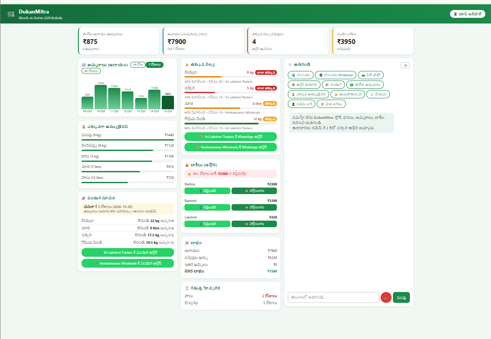
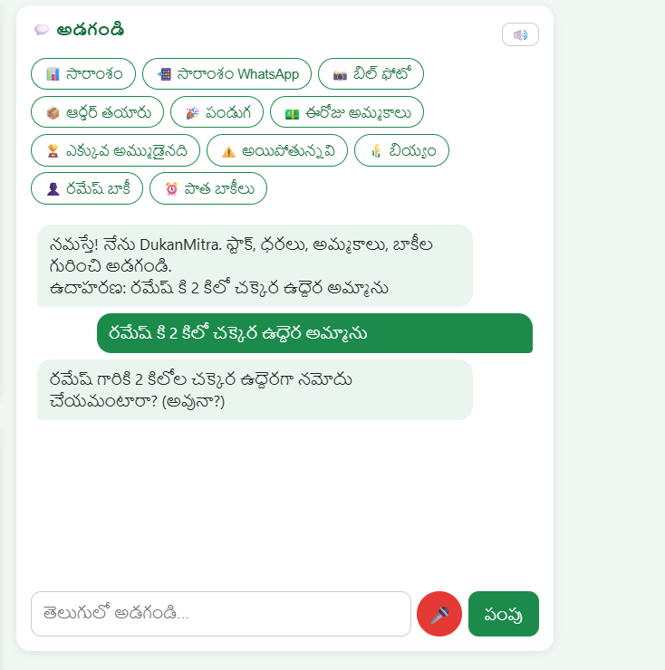
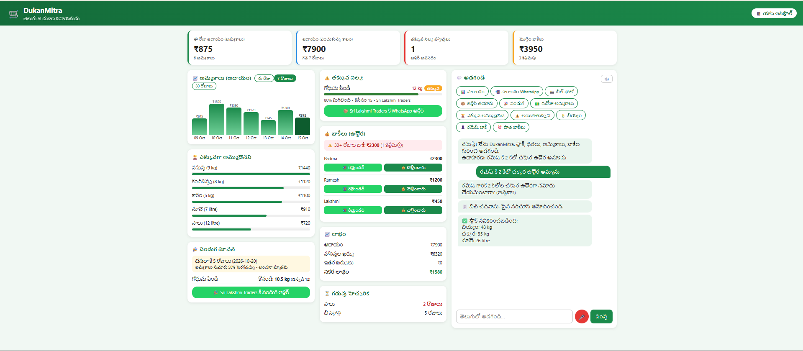
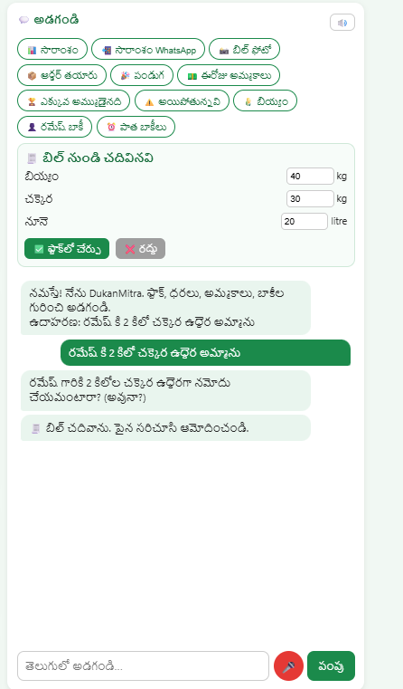
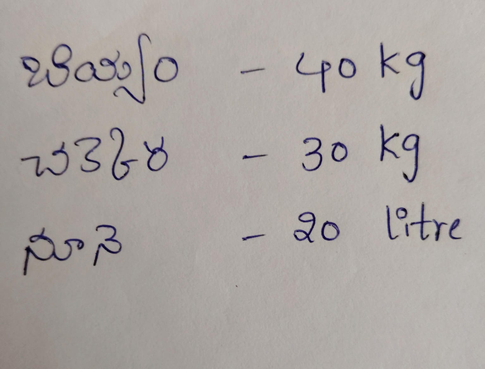
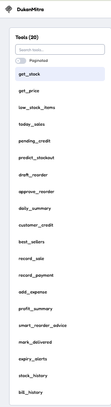

# DukanMitra

A Telugu/English voice-and-chat AI agent for small kirana (grocery) shop owners in India.
Built solo for the **Amazon Developer Hackathon, Alexa+ track** (self-hosted MCP server + a simulated assistant experience in a web app).

**Live demo:** https://dukanmitra.onrender.com
No login needed. The app runs on a free tier that sleeps when idle, so the first load can take 30-60 seconds. Demo data resets whenever the server restarts.

The owner asks about stock, sales, profit and customer credit in Telugu. The agent calls real tools (exposed over an **MCP server**), predicts stock-outs, recommends reorder quantities, and **never changes data without explicit owner confirmation** (Ask -> Analyze -> Recommend -> Confirm).

## The problem
Millions of small shopkeepers in Telugu-speaking regions track stock and credit ("udhar") in notebooks. They lose money to stock-outs, expired goods and unpaid dues, and almost every dashboard is in English.

## What it does
**MCP server** (`mcp_server.py`, Streamable HTTP, spec 2025-11-25, endpoint `/mcp`) exposing 20 tools: stock, price, sales, best sellers, customer credit, payments, expenses, profit summary, stock history, bill history, expiry alerts, stock-out prediction, smart reorder advice, draft/approve/deliver reorders, record sale.

**Telugu AI agent** (Google Gemini function calling, per-session memory) that uses the same business tools.

**Web app / dashboard**
- Revenue, cost of goods, expenses and net profit shown separately; 7/30-day charts; best sellers
- Low-stock bars (current stock vs minimum) and expiry warnings
- Credit ageing: dues are colour-coded by days pending, with a warning for 30+ day dues
- One-tap WhatsApp reminders to customers and WhatsApp orders to suppliers (deep links, no API key)
- Payment entry button for customer dues
- Supplier bill photo -> stock entry (Gemini vision; the owner reviews and confirms before stock changes)
- Festival stock suggestions (Dasara, Diwali, Sankranti, Ugadi), based on the last 7 days of sales
- Owner approval for reorders (order cards and confirm dialogs)
- Telugu voice input (`te-IN`) and spoken replies (browser speech APIs)
- Installable PWA, mobile-responsive

## Screenshots
| Dashboard | Chat: credit sale with confirmation |
|---|---|
|  |  |

**Supplier bill photo to stock entry** (the owner reviews before stock changes)

| 1. Photo of the bill | 2. AI reads it, owner confirms |
|---|---|
|  |  |

| Mobile view | MCP server in MCP Inspector (20 tools) |
|---|---|
|  |  |

## Safety by design
- Data-changing actions (record sale, record payment, approve reorder, add expense, mark delivered, bill stock entry) need explicit owner confirmation.
- Numbers come from database tools, not from the model's guesses.
- Forecasts, reorder quantities and festival suggestions are labelled as estimates.
- Revenue is never presented as profit.

## Architecture
```
Browser (PWA, Telugu voice/chat)
        |
        v
Django views (agent_api/views.py) ---> Gemini agent (agent_api/agent.py, tool calling)
                                                   |
MCP client (e.g. MCP Inspector)                    v
        |                                  agent_api/tools.py  (business logic)
        v                                          |
mcp_server.py (FastMCP, /mcp) ------------------>  v
                                          Django ORM + SQLite (shop/models.py)
```
- `mcp_server.py` - MCP server (port 8000, endpoint `/mcp`)
- `agent_api/tools.py` - business logic shared by the MCP server and the web app
- `agent_api/agent.py` - Gemini agent with tool calling
- `agent_api/bill.py` - bill photo scan (Gemini vision) and owner-approved stock update
- `agent_api/festival.py` - festival suggestions
- `agent_api/views.py`, `agent_api/templates/chat.html` - web UI and APIs
- `shop/` - models and `seed_data.py` (demo data)

## Run locally
Python 3.12 recommended.
```bash
git clone https://github.com/mangalapurivijayalakshmi/DukanMitra.git
cd DukanMitra
python -m venv venv
venv\Scripts\activate        # Windows (Mac/Linux: source venv/bin/activate)
pip install -r requirements.txt
```
Create a `.env` file:
```
GEMINI_API_KEY=your-key
```
Set up the database (SQLite, no extra setup) and load demo data:
```bash
python manage.py migrate
python manage.py shell -c "from shop.seed_data import run; run()"
```

Terminal 1 - MCP server:
```bash
python mcp_server.py
```
Inspect it: `npx @modelcontextprotocol/inspector`, choose transport **Streamable HTTP**, URL `http://127.0.0.1:8000/mcp`.

Terminal 2 - web app:
```bash
python manage.py runserver 8001
```
Open http://127.0.0.1:8001

## Deployment
The web app is hosted on Render (free tier):
- Build: `pip install -r requirements.txt`
- Start: `python manage.py migrate && python manage.py shell -c "from shop.seed_data import run; run()" && gunicorn config.wsgi:application --bind 0.0.0.0:$PORT --workers 2 --timeout 120`
- Environment variables: `GEMINI_API_KEY`, `SECRET_KEY`, `DEBUG=False`, `ALLOWED_HOSTS`, `CSRF_TRUSTED_ORIGINS`

The hosted instance runs the web app. The MCP server is run locally as shown above (see the demo video).

## Testing instructions for judges
1. Open the live demo. Wait up to 60 seconds on the first load.
2. Try these prompts in the chat (English meaning in brackets):
   - `ఈ వారం లాభం ఎంత?` (What is this week's profit?)
   - `రేపు ఏం కొనాలి?` (What should I buy tomorrow? - an estimate)
   - `ఎవరి బాకీ ఎక్కువ రోజులుగా ఉంది?` (Whose dues are the oldest?)
   - `రాబోయే పండుగకు ఏం కొనాలి?` (What to stock for the next festival?)
   - `రమేష్ కి 2 కిలో చక్కెర ఉద్దెర అమ్మాను` (I sold 2 kg sugar to Ramesh on credit) - the agent asks for confirmation before recording.
3. On the dashboard: click "Remind" next to a customer, "Paid" to record a payment, and the bill-photo button to scan a supplier bill.
4. To test the MCP server, follow "Run locally" and connect MCP Inspector to `/mcp`.

## What was built during the hackathon
Everything in this repository was built during the submission period (Aug 31 - Oct 23, 2026): the MCP server, the Gemini agent and tools, the dashboard, WhatsApp reminders and orders, credit ageing, bill photo scan, festival suggestions, PWA and deployment.

## Limitations (honest notes)
- Demo data only; purchase prices in `seed_data.py` are illustrative.
- No login yet; this is a single-shop demo. SQLite data resets on every restart of the hosted demo.
- Festival dates and suggested quantities are estimates from a demo calendar and the last 7 days of sales.
- Stock-out and reorder figures are estimates, not guarantees.
- The hosted free-tier AI features depend on the Gemini API quota.
- Amazon Bedrock was attempted, but model invocation was blocked on our free-plan account (see `docs/friction_log.md`), so Gemini is used.

## Future work
Login and multi-shop support, PostgreSQL, UPI payment links, demand forecasting with more history, PDF receipts, automated tests, more Indian languages.

## Author
Solo project by Mangalapuri Vijayalakshmi (GitHub: [@mangalapurivijayalakshmi1432@gmail.com]
(https://github.com/mangalapurivijayalakshmi/DukanMitra)).

## License
MIT
