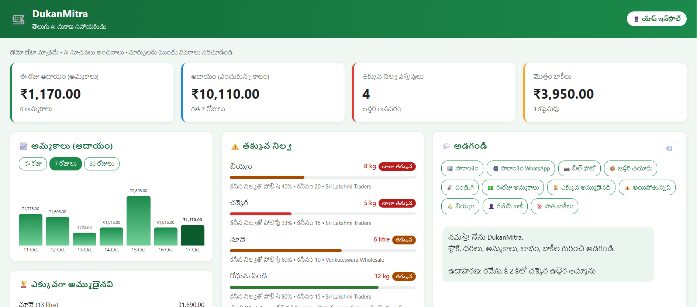
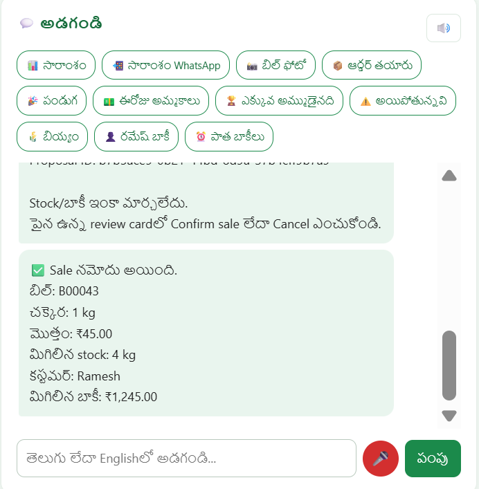

# DukanMitra

### A Telugu-first AI assistant for small kirana shops

Ask about stock, sales, profit, and customer credit in Telugu or English. Prepare a sale through conversation, review the exact transaction, and confirm it before the server updates shop records.

Built solo for the Amazon Developer Hackathon 2026 — Alexa+ track.

[Live Demo](https://dukanmitra.onrender.com) · [Source Code](https://github.com/mangalapurivijayalakshmi/DukanMitra)

<!-- Add the public demo-video link here before submission:
[Demo Video](YOUR_PUBLIC_VIDEO_URL)
-->

> No login is required for the hosted demonstration. The free-tier service may take 30–60 seconds to wake up. This is a shared, single-shop demo using illustrative data. Hosted data may reset when the service restarts or redeploys.

---

## The problem

Small kirana shop owners often track stock, sales, and customer credit—also called udhar—in notebooks.

Everyday questions can require checking several records:

- How much sugar is left?
- What was this week's profit?
- Which customers have overdue dues?
- What should I reorder?
- How should I enter items from a supplier bill?

DukanMitra combines a Telugu-first conversational assistant with a visual shop dashboard.

The goal is to make routine shop information accessible in the owner's own language while keeping the owner in control of consequential actions.

## Project status

The hosted web application includes:

- Telugu and English chat.
- Business-data tools.
- A shop dashboard.
- A server-stored sale-proposal workflow.
- Explicit Confirm/Cancel controls for conversational sales.
- Supplier bill scanning and review.
- Customer payment and WhatsApp workflows.
- Stock-planning estimates.
- Browser voice input and spoken replies.
- PWA support.

A separate self-hosted MCP server exposes the shared business tools.

### Alexa+ simulation boundary

The browser application is a simulated assistant experience powered by Google Gemini.

It is not a live Alexa+ integration.

The web agent calls shared Python business logic directly. The MCP server exposes business tools to MCP clients such as MCP Inspector.

The hosted website does not also host the separate MCP server.

## Main workflow

Ask → Analyze → Propose → Review → Confirm → Execute

For conversational sales:

1. The owner describes a sale.
2. The agent calls a proposal tool.
3. The server validates the product, quantity, payment method, and customer.
4. The server stores a pending action with its exact arguments and review preview.
5. The interface displays a sale-review card.
6. The owner selects Confirm sale or Cancel.
7. The confirmation endpoint validates the stored proposal before execution.

The model does not directly execute the sale.

### Example

Owner:

> రమేష్ కి 2 కిలో చక్కెర ఉద్దెర అమ్మాను  
> I sold 2 kg of sugar to Ramesh on credit.

The review card shows:

```text
Item: Sugar
Quantity: 2 kg
Total: ₹90
Payment: Credit
Customer: Ramesh

If approved:
Stock: 5 → 3 kg
Customer dues: ₹1,200 → ₹1,290

[Confirm sale] [Cancel]
```

These numbers are an example from demo testing. Actual values come from the current database.

Typing “yes” or “అవును” alone does not execute a sale. The owner uses the review card.

## Features

### Telugu and English assistant

- Telugu-first responses, with English available when requested.
- Database tools for stock, prices, sales, credit, and profit questions.
- Gemini function calling.
- Telugu voice input using browser speech recognition.
- Spoken responses using browser speech synthesis.

The current chat implementation handles self-contained requests. It does not retain multi-turn conversation history.

Voice support and Telugu voice availability vary by browser and device.

### Shop dashboard

- Today's revenue and sale count.
- Revenue for the selected reporting period.
- Sales charts with 1-day, 7-day, and 30-day options.
- Best-selling products.
- Low-stock indicators.
- Out-of-stock alerts.
- Customer credit balances.
- Credit-ageing indicators and overdue warnings.
- Revenue, cost of goods, expenses, and net profit displayed separately.
- Product expiry alerts.

### Conversational sale approval

- Server-stored pending proposals.
- Product and customer IDs stored with transaction arguments.
- A reviewable preview of quantity, price, total, stock, and credit changes.
- Browser-session binding.
- Ten-minute proposal validity.
- Confirm and Cancel controls.
- Validation of current business data before execution.
- Stored execution results.
- Sequential duplicate-confirm handling for an executed proposal.

### Customer credit

- Customer balances and days pending.
- Warnings for dues pending 30 days or more.
- Dashboard payment entry.
- WhatsApp reminder links with prefilled messages.

WhatsApp links open a message for the owner to review and send. They do not automatically send messages through the WhatsApp Business API.

### Stock planning

- Estimated stock-out timing.
- Suggested reorder quantities.
- Supplier reorder drafts.
- Reorder approval and delivery business tools.
- WhatsApp supplier-order links.
- Festival stock suggestions.

Forecasts, suggested quantities, and festival demand increases are estimates.

### Supplier bill scanning

1. Upload a supplier bill photo.
2. Gemini vision extracts items and quantities.
3. Review the extracted information.
4. Approve stock entry through the dashboard workflow.

AI extraction can contain errors. Product matching, quantities, and units must be checked before approval.

### Installable web app

- Responsive layout.
- Web app manifest and service worker.
- PWA installation where supported by the browser.

## Screenshots

### Dashboard overview



### Sale review before confirmation

The owner reviews the proposed sale before any sale-related changes are made.


### Confirmed sale

The result is shown after the owner confirms the sale.



## Architecture

```text
Browser
Dashboard · Telugu/English chat · Voice · PWA
        |
        v
Django views and API endpoints
        |
        +--> Gemini agent
        |       |
        |       +--> Read-only business tools
        |       |
        |       +--> Sale proposal tool
        |                   |
        |                   v
        |              PendingAction
        |                   |
        +--> Owner Confirm/Cancel endpoint
                            |
                            v
                    Approval service
                            |
                            v
                 Django ORM + SQLite


Separate MCP client
        |
        v
Self-hosted MCP server
        |
        v
Shared business tools
        |
        v
Django ORM + SQLite
```

### Important architectural distinction

The web agent does not route every request through MCP.

The web application and MCP server reuse business-tool code, but the conversational sale-approval service is a separate application-controlled execution path.

## Main files

| File | Responsibility |
|---|---|
| `agent_api/agent.py` | Gemini requests, read tools, customer aliases, sale proposals |
| `agent_api/approvals.py` | Session-bound sale confirmation, cancellation, and execution |
| `agent_api/views.py` | Web views and API endpoints |
| `agent_api/urls.py` | Application routes |
| `agent_api/tools.py` | Shared business functions |
| `agent_api/bill.py` | Bill extraction and stock-entry logic |
| `agent_api/festival.py` | Festival stock suggestions |
| `agent_api/templates/chat.html` | Dashboard, chat, and review controls |
| `agent_api/test_approval_safety.py` | Automated approval safety tests |
| `shop/models.py` | Shop records and pending-action model |
| `shop/migrations/` | Database schema migrations |
| `shop/seed_data.py` | Demonstration dataset |
| `mcp_server.py` | Self-hosted MCP server |

## Sale-approval safety

### Server-stored proposals

Transaction arguments and the owner-facing preview are stored in the database rather than reconstructed from a later model response.

### Session binding

The approval API uses the Django server session.

It does not accept a browser-supplied session identifier as the authority to execute another session's proposal.

Session binding is not authentication. This remains a public, single-shop demonstration.

### Expiry and state checks

The approval service checks proposal ownership, expiry, action type, and status.

Executed and cancelled proposals are not treated as new pending sales.

### Fresh business-data validation

The service validates current product and customer data against the reviewed preview.

If relevant values change, it rejects the stale proposal rather than silently executing different terms.

### Transactional execution

The sale record, stock deduction, customer credit update, stock movement, and proposal execution result are handled within a database transaction.

Conditional updates are also used in the execution path.

### Scope of this protection

This server-stored approval workflow currently covers conversational sales.

It does not yet provide uniform approval enforcement across every dashboard and MCP write operation.

The current web agent does not expose direct payment, expense, reorder-approval, or delivery write tools to the model. Other interfaces may still expose those capabilities.

## Verification completed

### Manual local checks

- Creating a sale proposal left stock and customer dues unchanged.
- Confirming a proposal recorded a sale and updated related records.
- Cancelling a proposal left business data unchanged.
- Confirming an already-executed proposal again returned the stored result without another sale.

### Automated service tests

Three tests cover:

1. An expired proposal cannot execute.
2. A different session cannot confirm the owner's proposal.
3. A different session cannot cancel the owner's proposal.

These are service-level tests. They do not establish full HTTP/CSRF coverage, concurrent-request correctness, or protection of every write path.

## Technology stack

| Layer | Technology |
|---|---|
| Language | Python |
| Web backend | Django |
| Demo database | SQLite |
| AI | Google Gemini, Google Gen AI SDK |
| MCP | FastMCP, Streamable HTTP |
| Frontend | HTML, CSS, JavaScript |
| Voice | Browser speech APIs |
| Messaging handoff | WhatsApp deep links |
| Web server | Gunicorn |
| Hosting | Render |

The verified development/deployment setup uses Python 3.13.5 and Django 6.1.2.

Dependency versions are recorded in `requirements.txt`.

## Run locally

### 1. Clone the repository

```bash
git clone [https://github.com/mangalapurivijayalakshmi/DukanMitra.git](https://github.com/mangalapurivijayalakshmi/DukanMitra.git)
cd DukanMitra
```

### 2. Create a virtual environment

```bash
python -m venv venv
```

Windows Command Prompt:

```bat
venv\Scripts\activate
```

macOS / Linux:

```bash
source venv/bin/activate
```

### 3. Install dependencies

```bash
python -m pip install -r requirements.txt
```

### 4. Create `.env`

Create a `.env` file in the project root:

```env
DEBUG=True
SECRET_KEY=replace-with-your-own-random-secret
GEMINI_API_KEY=your-gemini-api-key

ALLOWED_HOSTS=127.0.0.1,localhost
CSRF_TRUSTED_ORIGINS=http://127.0.0.1:8001,http://localhost:8001

TRUST_PROXY_SSL_HEADER=False
SESSION_COOKIE_SECURE=False
CSRF_COOKIE_SECURE=False
SECURE_SSL_REDIRECT=False
```

Generate a Django secret with:

```bash
python -c "from django.core.management.utils import get_random_secret_key; print(get_random_secret_key())"
```

Do not commit `.env`, API keys, or other secrets.

The agent's model can be overridden using the optional `GEMINI_MODEL` environment variable.

### 5. Apply migrations

```bash
python manage.py migrate
```

### 6. Load demonstration data

```bash
python manage.py shell -c "from shop.seed_data import run; run()"
```

Use the seed command for a disposable demo database, not a database containing real shop records.

### 7. Start the web app

```bash
python manage.py runserver 8001
```

Open:

```text
http://127.0.0.1:8001/
```

Use the same browser profile and hostname throughout a proposal/confirmation test.

### 8. Run the safety tests

```bash
python manage.py test agent_api.test_approval_safety --verbosity 2
```

Additional checks:

```bash
python manage.py check
python manage.py makemigrations shop --check --dry-run
python -m pip check
```

## MCP server

The MCP server is a separate process.

- Implementation: `mcp_server.py`
- Framework: FastMCP
- Transport: Streamable HTTP
- Local endpoint: `http://127.0.0.1:8000/mcp`
- Registered business tools: 20

### Start the server

In a separate terminal, activate the virtual environment and run:

```bash
python mcp_server.py
```

### Inspect the tools

With Node.js and npm available:

```bash
npx @modelcontextprotocol/inspector
```

In MCP Inspector:

1. Select Streamable HTTP.
2. Enter `http://127.0.0.1:8000/mcp`.
3. Connect.
4. List the tools.
5. Execute a read-only tool.

Example:

```text
Tool: get_stock
product_name: Sugar
```

Example response:

```json
{
  "found": true,
  "product": "చక్కెర",
  "stock": 3,
  "unit": "kg",
  "is_low": true
}
```

Actual values depend on the current database.

### Registered tools

```text
get_stock
get_price
low_stock_items
today_sales
pending_credit
predict_stockout
draft_reorder
approve_reorder
daily_summary
customer_credit
best_sellers
record_sale
record_payment
add_expense
profit_summary
smart_reorder_advice
mark_delivered
expiry_alerts
stock_history
bill_history
```

### MCP safety boundary

The MCP server includes data-changing tools.

Those direct tools are not yet uniformly protected by the web sale-proposal approval service. Tool descriptions asking for confirmation are not equivalent to server-enforced approval.

Use a disposable demo database for MCP testing. Do not expose the write-capable MCP server publicly or connect it to real shop data without authentication, authorization, and appropriate approval enforcement.

## Judge testing guide

### A. Open the hosted app

Visit:

```text
[https://dukanmitra.onrender.com](https://dukanmitra.onrender.com)
```

Allow time for the free-tier service to wake up.

### B. Ask a read-only question

```text
ఈ వారం లాభం ఎంత?
```

Meaning:

```text
What is this week's profit?
```

Other examples:

| Telugu prompt | English meaning |
|---|---|
| `బియ్యం స్టాక్ ఎంత ఉంది?` | How much rice is in stock? |
| `రేపు ఏం కొనాలి?` | What should I buy tomorrow? |
| `ఎవరి బాకీ ఎక్కువ రోజులుగా ఉంది?` | Whose dues have been pending the longest? |
| `రాబోయే పండుగకు ఏం కొనాలి?` | What should I stock for the upcoming festival? |

### C. Test cancellation

1. Ask: `రమేష్ కి 1 కిలో చక్కెర ఉద్దెర అమ్మాను`.
2. Review the proposed sale.
3. Note the displayed stock and credit balance.
4. Select Cancel.
5. Verify that no sale-related stock or credit change occurred.

### D. Test confirmation

1. Submit a new sale request.
2. Review quantity, price, total, customer, and proposed changes.
3. Select Confirm sale.
4. Approve the browser confirmation.
5. Check the bill number and updated dashboard values.

Typing “అవును” alone does not confirm a sale.

### E. Test MCP separately

Run the local MCP server and connect MCP Inspector as described above.

The hosted web demo and local MCP server are separate testing surfaces.

## Deployment

The web app is hosted on Render.

### Build command

```bash
pip install -r requirements.txt
```

### Demo start command

```bash
python manage.py migrate && python manage.py shell -c "from shop.seed_data import run; run()" && gunicorn config.wsgi:application --bind 0.0.0.0:$PORT --workers 1 --timeout 120
```

This command seeds demonstration data during startup. It is not intended as a production data-management strategy.

### Environment configuration

```text
PYTHON_VERSION=3.13.5
DEBUG=False
ALLOWED_HOSTS=dukanmitra.onrender.com
CSRF_TRUSTED_ORIGINS=[https://dukanmitra.onrender.com](https://dukanmitra.onrender.com)
TRUST_PROXY_SSL_HEADER=True
SESSION_COOKIE_SECURE=True
CSRF_COOKIE_SECURE=True
SECURE_SSL_REDIRECT=True
```

Also configure secret values for:

```text
SECRET_KEY
GEMINI_API_KEY
```

The proxy-header setting assumes deployment behind the trusted hosting proxy.

### Hosted-demo boundaries

- The deployment runs the web application.
- The MCP server is demonstrated separately.
- SQLite is used for demonstration.
- Hosted records may reset on restart or redeployment.
- The public demo is shared between visitors.
- A browser refresh is not the same as a service restart.

## Known limitations

- No login, owner authentication, or multi-shop isolation.
- Session-bound proposals do not make a public shared shop private.
- No retained multi-turn chat history in the current agent.
- Customer aliases are explicit mappings for the demo dataset, not general transliteration.
- Alias handling is not yet unified across all read and write tools.
- Approval enforcement is not uniform across every dashboard and MCP write path.
- Money fields currently use floating-point storage.
- Profit uses current product purchase prices, not historical sale-time cost snapshots.
- Credit sales update customer balances, but the current Sale model has no direct customer relationship.
- Sales-history windows are not yet fully standardized across all analytics and forecasting tools.
- Bill extraction and unit interpretation require careful human review.
- Forecasts use limited sales history and are not guarantees.
- Festival dates and demand suggestions use demonstration assumptions.
- Browser voice and installation support vary.
- AI features depend on Gemini quota and availability.
- Offline-caching behaviour and broader concurrency scenarios need additional review.
- The current tests do not provide complete HTTP, CSRF, load, or multi-process coverage.

## Work completed during the hackathon

Development during the submission period includes:

- Django models and demonstration data.
- Shared shop business tools.
- Self-hosted MCP server.
- Gemini agent.
- Telugu and English interface.
- Sales, stock, profit, and credit dashboard.
- Customer credit-ageing indicators.
- WhatsApp reminder and supplier-order links.
- Bill-photo extraction and review.
- Stock-planning and festival estimates.
- Browser voice interaction.
- PWA support.
- Server-stored conversational sale proposals.
- Confirm/Cancel execution service.
- Approval safety tests.
- Render deployment.

## Development friction

Amazon Bedrock was attempted, but model invocation was blocked on the account used for this project.

Gemini was used for the working assistant and bill extraction.

See [the friction log](docs/friction_log.md) for recorded setup attempts, errors, and the fallback approach.

## Future work

- Authentication and shop-level authorization.
- Persistent PostgreSQL storage.
- Unified approval enforcement across all write interfaces.
- HTTP/CSRF integration and concurrency tests.
- Persistent, bounded conversation history.
- Shared customer/product alias resolution.
- Decimal money fields.
- Sale-time cost snapshots and customer-linked credit-sale records.
- Stronger bill schema validation and explicit unit conversion.
- Consistent analytics date ranges.
- Production-ready MCP access controls.
- UPI links, PDF receipts, and more Indian languages.

## Author

Mangalapuri Vijayalakshmi

Solo developer of DukanMitra.

[GitHub](https://github.com/mangalapurivijayalakshmi) · [Repository](https://github.com/mangalapurivijayalakshmi/DukanMitra)

## License

MIT. See [LICENSE](LICENSE).